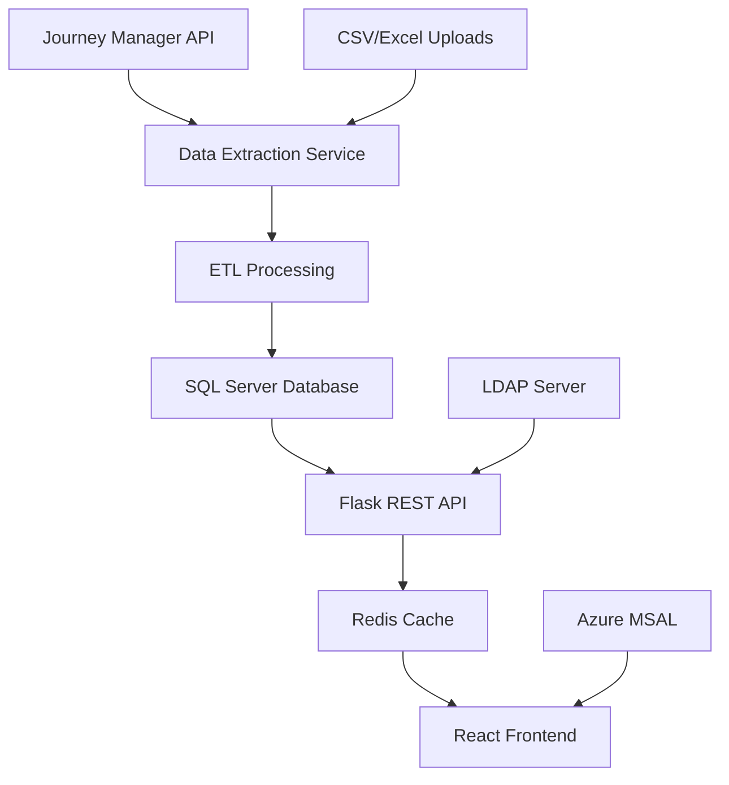
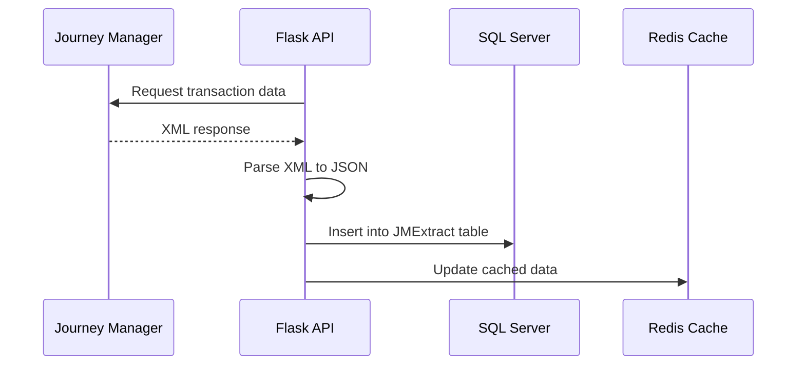
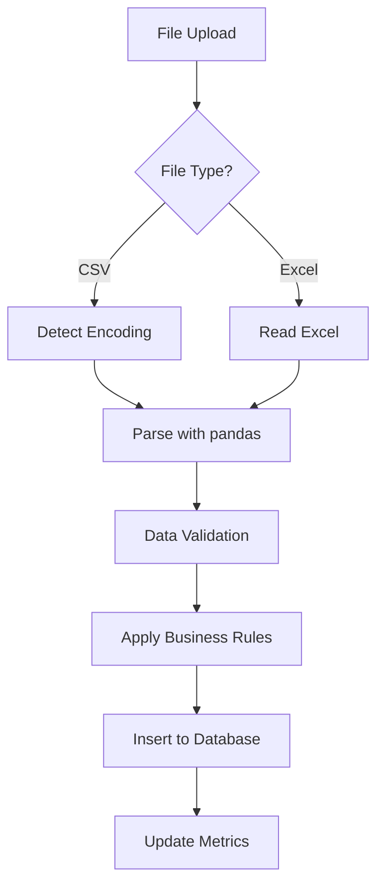
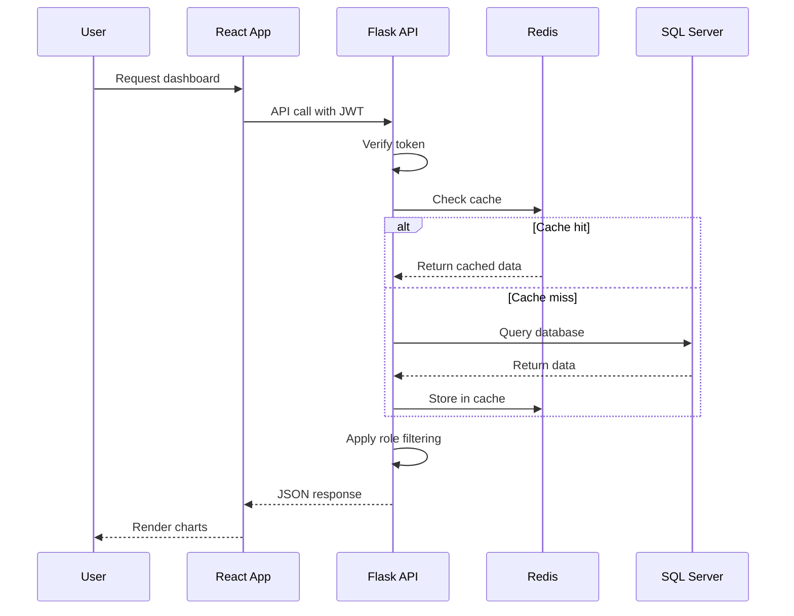
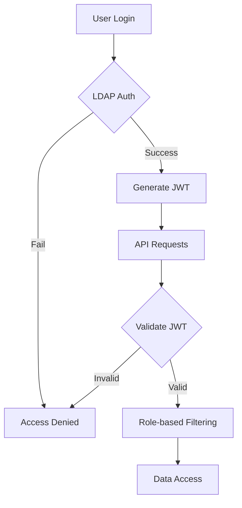
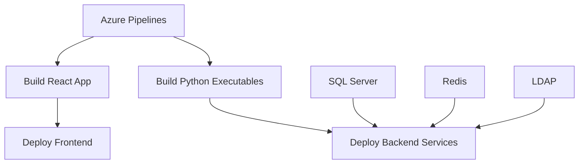

# System Architecture

## Overview

The eStore Digital Reporting System is a web-based analytics platform that integrates multiple data sources to provide comprehensive reporting and visualization capabilities for financial transactions.

## High-Level Architecture

## Data Flow

### Transaction Data Ingestion

### CSV Processing Flow

### User Request Flow

## Component Details

### Frontend (React Application)
- **Framework**: React 18.2.0 with hooks
- **UI Library**: PrimeReact components
- **Charts**: Chart.js with react-chartjs-2
- **Authentication**: Azure MSAL Browser
- **State Management**: React state with context

### Backend (Flask API Server)
- **Framework**: Flask 3.0.3 with CORS
- **Authentication**: JWT tokens with LDAP validation
- **Database**: SQL Server via pyodbc
- **Caching**: Redis for performance
- **XML Processing**: lxml library
- **File Processing**: pandas for CSV/Excel

### Database Layer
- **Primary DB**: SQL Server with encrypted connections
- **Tables**:
  - JMExtract: Raw Journey Manager data
  - Transactions: Processed transaction data
  - Users: User management and roles
  - Metrics: System performance data

### Caching Layer
- **Technology**: Redis
- **Purpose**: Cache chart data and API responses
- **Invalidation**: Time-based and manual clearing
- **Pre-generation**: cache_gen.exe for proactive caching

### Executable Components
- **serve.exe**: Main Flask server
- **csvLoader.exe**: Batch CSV processing
- **cache_gen.exe**: Cache pre-generation

## Security Architecture

## Deployment Architecture

## Performance Considerations

- **Caching Strategy**: Redis cache for frequently accessed data
- **Database Optimization**: Indexed queries and connection pooling
- **File Processing**: Streaming for large CSV files
- **API Rate Limiting**: Built-in request throttling
- **Metrics Collection**: Performance monitoring and alerting

## Scalability

- **Horizontal Scaling**: Multiple API server instances
- **Database Sharding**: Partitioning for large datasets
- **Cache Distribution**: Redis cluster for high availability
- **Load Balancing**: Distribute requests across servers