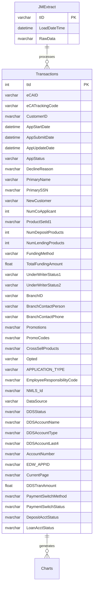
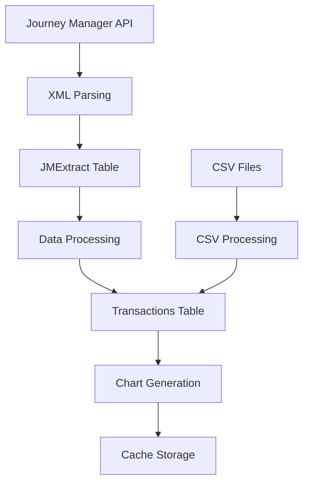

# Database Schema

## Overview

The eStore system uses Microsoft SQL Server as its primary database, with data stored in the `DigitalReport` database. The schema includes tables for transaction data, extracted XML data, and system metadata.

## Entity Relationship Diagram

## Tables

### Transactions Table

**Schema:** `[DigitalReport].[dbo].[Transactions]`

**Purpose:** Stores processed transaction data from various sources including Journey Manager and CSV uploads.

**Key Columns:**
- `tId` (INT, PRIMARY KEY): Unique transaction identifier
- `eCAID` (VARCHAR(50)): Electronic Customer Application ID
- `eCATrackingCode` (VARCHAR(50)): Tracking code for the application
- `CustomerID` (NVARCHAR(128)): Customer identifier
- `AppStartDate` (DATETIME): When application was started
- `AppSubmitDate` (DATETIME): When application was submitted
- `AppStatus` (VARCHAR(50)): Current status of the application
- `PrimaryName` (VARCHAR(50)): Primary applicant's name
- `PrimarySSN` (NVARCHAR(100)): Primary applicant's SSN (encrypted)
- `BranchID` (VARCHAR(15)): Branch identifier
- `TotalFundingAmount` (FLOAT): Total amount being funded
- `ProductSetId1` (NVARCHAR(MAX)): Product configuration
- `DataSource` (VARCHAR(250)): Source of the data (JM, CSV, etc.)

### JMExtract Table

**Schema:** `[DigitalReport].[dbo].[JMExtract]`

**Purpose:** Raw XML data extracted from Journey Manager API responses.

**Columns:**
- `tID` (VARCHAR, PRIMARY KEY): Tracking ID from Journey Manager
- `LoadDateTime` (DATETIME): When the data was loaded
- `RawData` (NVARCHAR(MAX)): JSON representation of parsed XML data

### Metrics Table

**Purpose:** System performance and usage metrics.

**Columns:**
- Timestamp of metric collection
- Metric name/type
- Metric value
- Additional context data

## Data Flow

## Indexes

### Transactions Table Indexes
- Primary Key on `tId`
- Index on `AppSubmitDate` for date range queries
- Index on `AppStatus` for status filtering
- Index on `BranchID` for branch-based queries
- Index on `CustomerID` for customer lookups

### JMExtract Table Indexes
- Primary Key on `tID`
- Index on `LoadDateTime` for temporal queries

## Constraints

### Data Integrity
- `tId` must be unique and not null
- `eCAID` and `eCATrackingCode` are required for valid transactions
- Date fields must be valid datetime values
- SSN fields are encrypted at rest

### Business Rules
- Applications must have valid status transitions
- Funding amounts must be positive for approved applications
- Branch IDs must exist in the branch master data

## Data Types

### String Types
- `VARCHAR(n)`: ASCII strings with fixed length
- `NVARCHAR(n)`: Unicode strings with fixed length
- `NVARCHAR(MAX)`: Unicode strings with variable length

### Numeric Types
- `INT`: 32-bit integers
- `FLOAT`: Floating point numbers for monetary amounts

### Date/Time Types
- `DATETIME`: SQL Server datetime with time component

## Security

### Encryption
- Column-level encryption enabled for sensitive data
- SSN and account numbers encrypted using SQL Server encryption
- Connection strings use integrated security

### Access Control
- Database access through application service accounts
- Role-based permissions at the database level
- Audit logging for data access

## Performance Considerations

### Partitioning
- Transactions table partitioned by `AppSubmitDate` for large datasets
- Historical data archived to separate tables

### Query Optimization
- Covering indexes for common query patterns
- Query hints for complex analytical queries
- Statistics updated regularly for optimal execution plans

### Connection Management
- Connection pooling enabled
- Connection timeout and retry logic
- Resource cleanup in application code